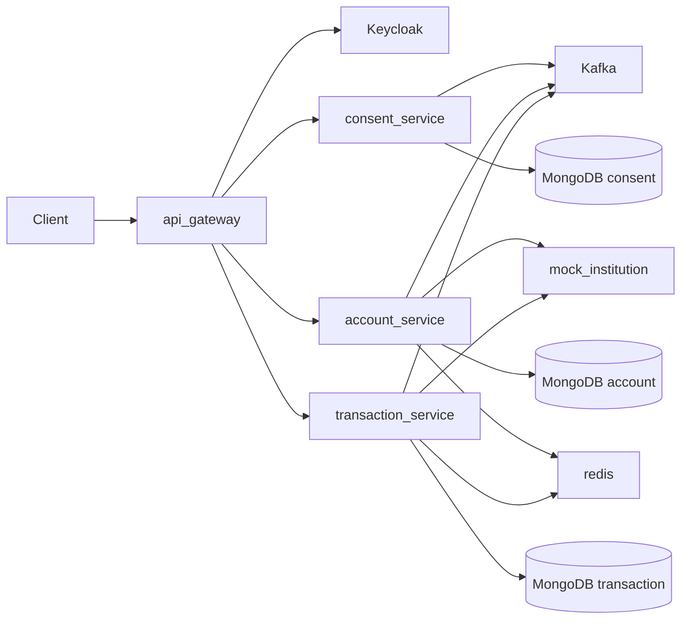

# Arquitetura — Open Finance fake MVP

## Objetivo

Simular fluxos inspirados no Open Finance Brasil (consentimento, contas, transações) com comunicação externa mockada, preparado para evoluir com FAPI, mTLS e APIs oficiais.

**Guia visual de comunicação (HTTP vs Kafka, Keycloak, DLQ):** [comunicacao.md](comunicacao.md)

## Microsserviços (visão compacta)

## Hexagonal (por serviço)

- `domain`: entidades, regras, ports
- `application`: casos de uso
- `adapter/in`: REST, Kafka consumers
- `adapter/out`: MongoDB, Redis, HTTP, Kafka producers
- `config`: Spring, segurança

## Eventos Kafka

| Tópico | Descrição |
|--------|-----------|
| `of.consent.created.v1` | Dispara sync de contas |
| `of.consent.revoked.v1` | Invalida cache Redis |
| `of.account.sync.completed.v1` | Dispara sync de transações |
| `of.account.sync.failed.v1` | Falha no sync de contas |

## Segurança

- **Keycloak** (Docker): realm `openfinance`, client `openfinance-app`, JWKS em `/realms/openfinance/protocol/openid-connect/certs`. Claim `customerId` no token via mapper do realm importado em [docker/keycloak/openfinance-realm.json](../docker/keycloak/openfinance-realm.json).
- **consent / account / transaction**: OAuth2 Resource Server (`jwk-set-uri` → Keycloak).
- **mock-institution**: header `X-API-Key` (serviço-a-serviço).

## Consistência

Sync assíncrono via Kafka: após criar consentimento, contas/transações podem levar alguns segundos. APIs retornam `409` se dados ainda não sincronizados.

## ADRs (leves)

1. **Database-per-service** em MongoDB para desacoplamento.
2. **Cache Redis** de consentimento autorizado (TTL 24h) preenchido pelo account-service no evento `consent.created`.
3. **Biblioteca `openfinance-events`** apenas com contratos de eventos (sem domínio compartilhado).

## DLQ (Kafka)

Consumers em **account-service** e **transaction-service**: retry (3×, intervalo 2 s) e republicação em `{topico}.dlq` via `DeadLetterPublishingRecoverer`.

## Evolução sugerida

- Alertas/monitoramento sobre tópicos `.dlq`
- Testcontainers nos testes de integração
- Schema Registry / Avro
- Pagamentos e webhooks PCM mockados
