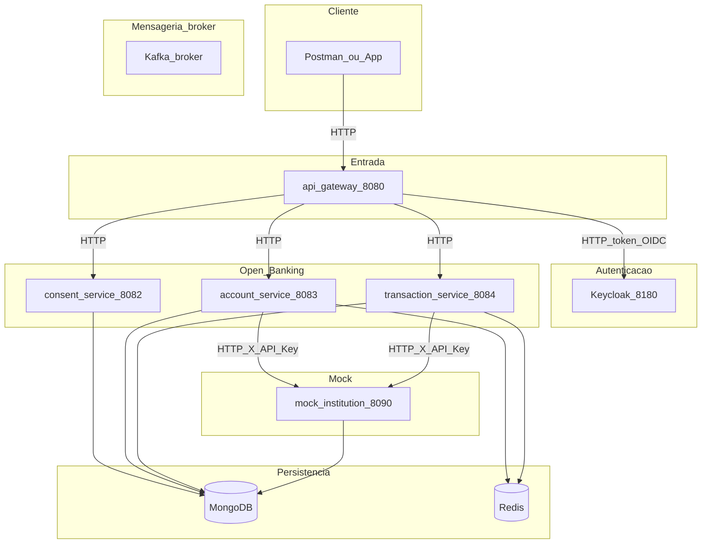
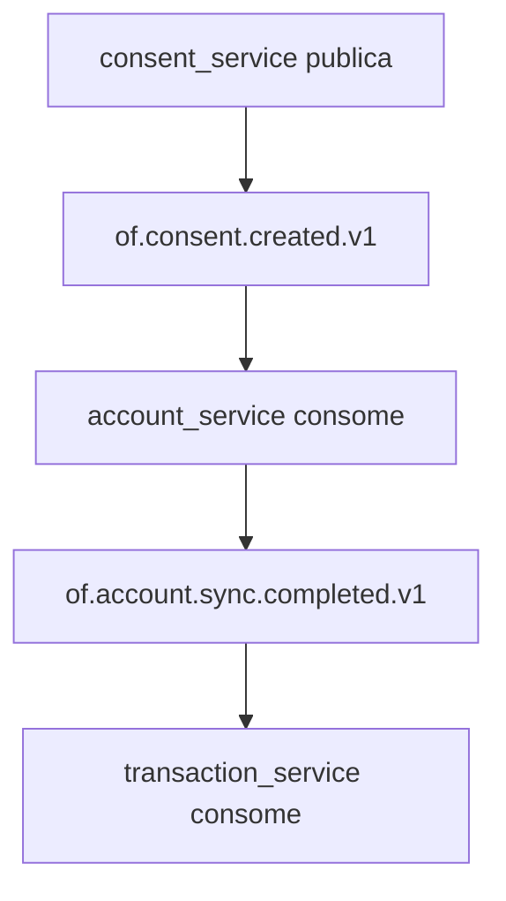
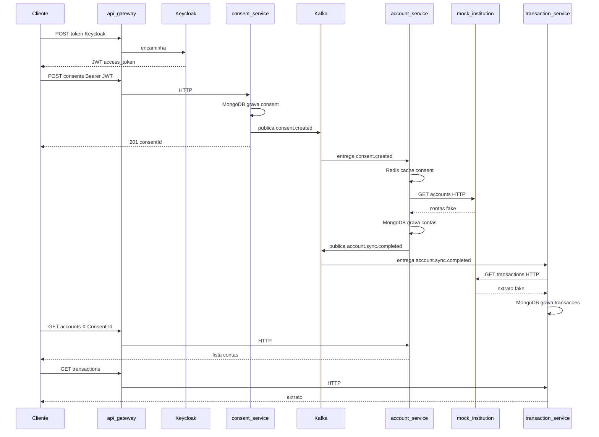
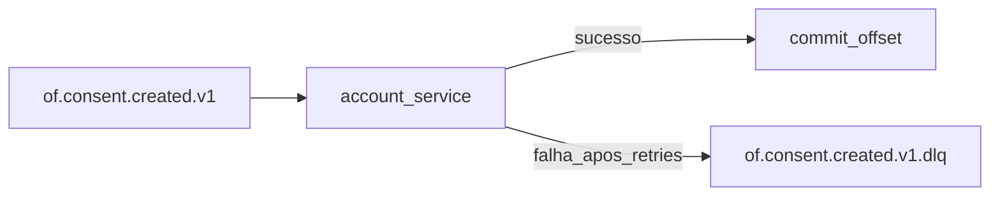

# Quem fala com quem — guia visual

**Versão interativa (abrir no navegador):** [comunicacao-visual.html](comunicacao-visual.html)

Este documento mostra **HTTP (síncrono)** e **Kafka (assíncrono)** separados. O cliente (Postman ou app) quase sempre entra pelo **api-gateway** na porta **8080**.

---

## 1. Mapa geral (HTTP)

Legenda:

- **Linha sólida** = chamada HTTP na hora (pede e espera resposta).
- **Caixa cinza** = infra (MongoDB, Redis, Kafka broker).
- **mock-institution** = banco fake; o cliente final **não** chama direto.

**Autenticação:** apenas **Keycloak** emite JWT (`POST .../protocol/openid-connect/token`).

**Confusões comuns**

- Kafka **não é webhook** — é fila; o serviço **consome** tópicos (@KafkaListener).
- Kafka **não traz contas/extrato** — só avisos (`consentId`, `accountIds`).
- **mock-institution** = banco detentor dos dados (seed no Mongo dele). account/transaction **puxam** com HTTP GET e guardam **cópia** nos seus Mongo.
- **Quem lê o extrato no fim** é o **cliente** (GET `/transactions`), não o mock-institution.

---

## 2. O que faz cada microsserviço (sem jargão Open Finance)

Imagine que você usa um **app de fintech** e quer ver suas contas de **outro banco** dentro desse app. No mundo real o banco precisa da sua **permissão**. Aqui tudo é **fake**, mas a ideia é a mesma.

| Serviço | O que é | O que faz neste projeto | Usa Kafka? |
|---------|---------|-------------------------|------------|
| **api-gateway** | Portaria | Uma URL só (`:8080`); encaminha para o serviço certo | Não |
| **Keycloak** | Login | Emite o token JWT (`demo` / `demo123`) | Não |
| **consent-service** | Termo de permissão | Você “aceita” compartilhar contas/extrato; grava no Mongo | **Publica** eventos |
| **account-service** | Suas contas no app | Copia contas do banco fake para o Mongo; API GET `/accounts` | **Consome e publica** |
| **transaction-service** | Extrato | Copia transações do banco fake; API GET `/transactions` | **Consome** |
| **mock-institution** | Banco detentor (fake) | **Um** banco só; seed com 2 contas + extrato do `customer-demo-001` | Não |

**O que tem no mock (seed):** contas `acc-checking-001` e `acc-savings-001` (agência, número, saldos) e transações de exemplo ligadas à conta corrente. Não há várias instituições financeiras — simula **um** participante detentor.

**Open Finance em uma frase:** provar quem você é (token) → dar consentimento → ler dados bancários que o “banco” expõe.

---

## 3. O que vai para o Kafka (não passa pelo gateway)

Kafka **não** aparece na URL do Postman. É **correio entre serviços**: um publica “aconteceu X”; outro reage depois.

Cada linha = **publica → tópico → consome** (ver também aba **Kafka** no [comunicacao-visual.html](comunicacao-visual.html)).

| # | Tópico | Quem publica | Quem consome | Significado prático |
|---|--------|--------------|--------------|---------------------|
| 1 | `of.consent.created.v1` | consent-service | account-service | “Consentimento OK; vá buscar as contas no banco fake.” |
| 2 | `of.consent.revoked.v1` | consent-service | account + transaction | “Permissão cancelada; tire do cache Redis.” |
| 3 | `of.account.sync.completed.v1` | account-service | transaction-service | “Contas já estão salvas; vá buscar o extrato.” |
| 4 | `of.account.sync.failed.v1` | account-service | (ninguém ainda) | “Deu erro ao sincronizar contas” (monitorar no Kafka UI) |

**Ordem no fluxo feliz:** linha 1 → account trabalha → linha 3 → transaction trabalha → aí sim o GET de contas/extrato funciona.

**Ordem típica após criar consentimento**

1. Cliente → gateway → **consent** (HTTP) → grava Mongo → **publica** `consent.created`.
2. **account** consome evento → Redis + HTTP mock-bank → Mongo → **publica** `account.sync.completed`.
3. **transaction** consome → HTTP mock-bank → Mongo.
4. Cliente → gateway → **account** / **transaction** (HTTP) lê o que já foi sincronizado.

Por isso, depois do POST de consent, espere **alguns segundos** antes de listar contas.

---

## 4. Fluxo feliz no tempo (sequência)

---

## 5. O que é DLQ no Kafka?

**DLQ** = **Dead Letter Queue** (fila de cartas mortas).

Quando um **consumer** processa uma mensagem e **falha** (bug, banco fora, timeout), você não quer:

- perder a mensagem silenciosamente, nem
- ficar reprocessando para sempre e travar a fila.

Padrão comum:

1. Tentar processar de novo algumas vezes (retry).
2. Se ainda falhar, mover a mensagem para um **tópico DLQ**, por exemplo `of.consent.created.v1.dlq`.
3. Alguém (humano, job ou alerta) inspeciona a DLQ depois.

**Implementado:** `account-service` e `transaction-service` usam `DefaultErrorHandler` + `DeadLetterPublishingRecoverer`: **3 retries** a cada **2 s**; depois a mensagem vai para `{topico}.dlq` (ex.: `of.consent.created.v1.dlq`). Inspecione no **Kafka UI** (`http://localhost:8099`). Config: `KafkaConsumerDlqConfig` em cada consumer.

---

## 6. Redis no desenho (resumo)

| Quem | Para quê |
|------|-----------|
| account-service | Escreve cache `consentId → customerId` quando chega `consent.created` |
| account / transaction | Leem cache nas APIs GET para saber se o consent ainda vale |

Kafka **não substitui** Redis aqui: Kafka = “aconteceu um evento”; Redis = “consulta rápida agora”.
